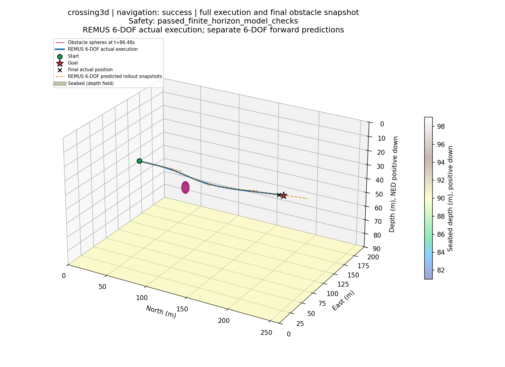
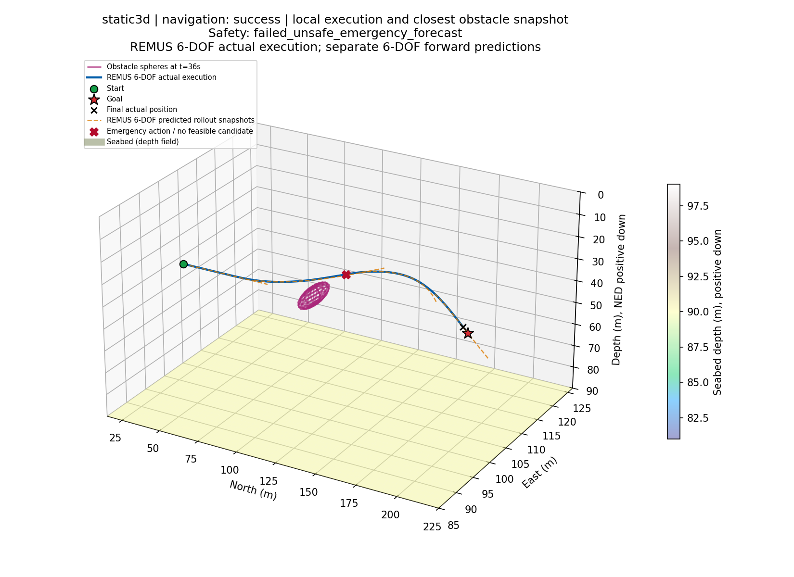
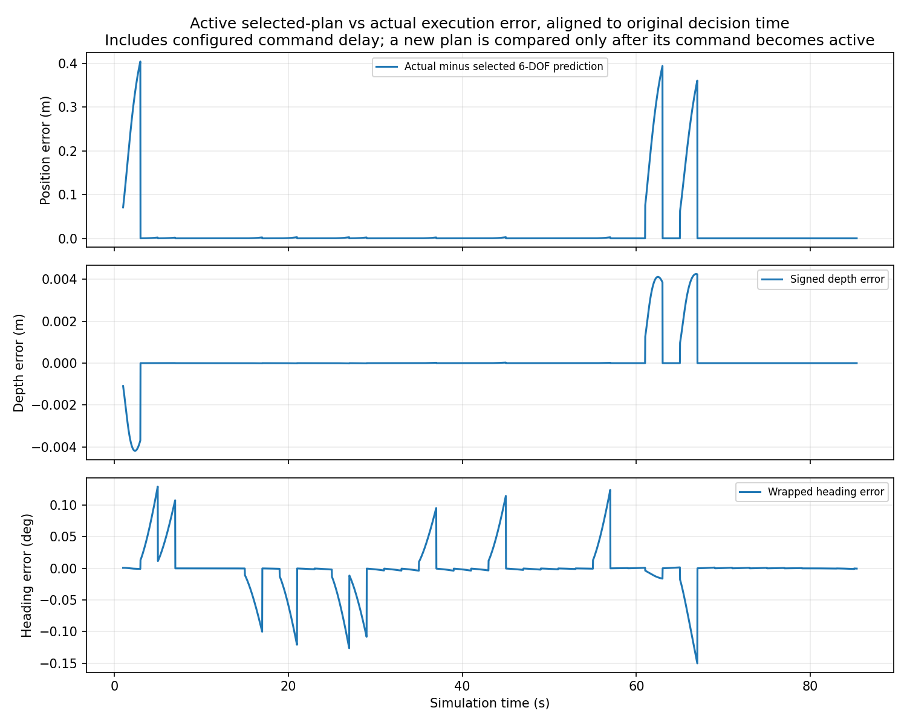
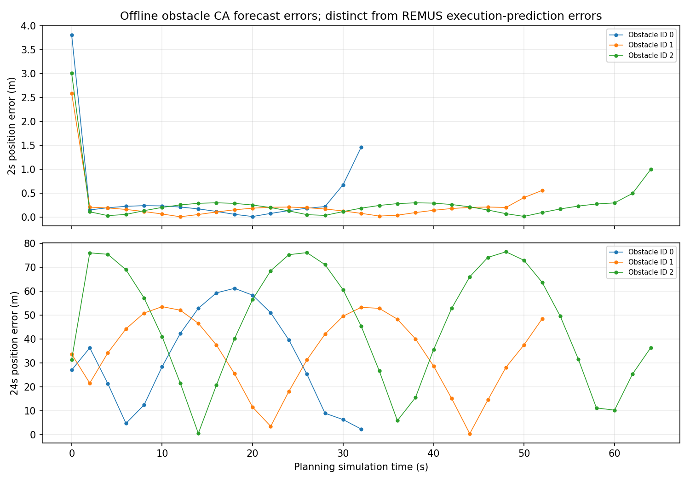

# 阶段2基线复审：实际测试记录

本轮使用Windows、独立Python3.12.14环境、CPU PyTorch2.10.0、NumPy2.3.5、Matplotlib3.10.8、pytest9.0.2。命令在现有主仓库执行，输出全部使用新目录。下面用仓库相对路径展示；独立交付ZIP中的原始JSON、命令日志和JUnit保留实际解释器、工作目录、起止时间与退出码。

## 代码与动力学回归

实际命令：

```powershell
$env:PYTHONUTF8 = '1'
$env:MPLBACKEND = 'Agg'
.\.venv-stage1\Scripts\python.exe scripts_stage2/run_regression.py --out results_stage2/review_20261011_regression
.\.venv-stage1\Scripts\python.exe scripts_stage2/run_regression.py --out results_stage2/review_20261011_final_regression
.\.venv-stage1\Scripts\python.exe scripts_stage2/run_regression.py --tests-only --out results_stage2/review_20261011_final_tests
.\.venv-stage1\Scripts\python.exe scripts_stage2/run_regression.py --tests-only --out results_stage2/review_20261011_publication_tests
```

首轮258项通过后又修复P25输入/边界/应急日志并加入测试，第二条完整回归实际345项通过且16条子命令退出码均为0。随后新增6项只读归因工具测试，第三条执行351项通过；最后汇总函数稳定后第四条在提交前再次执行351项，版本、依赖、审计与全部pytest通过：

| 检查 | 实际结果 |
| --- | --- |
| 全量pytest | **351项通过，0失败、0错误、0跳过** |
| 原PVS测试 | 原18项保留并执行 |
| 阶段1测试 | 原129项保留并执行 |
| 阶段2测试 | 既有104项加本轮100项，共204项 |
| 依赖 | `pip check`无冲突；版本清单已保存 |
| `run_stage1.py audit` | 原模型文件可用、接口/质量矩阵等参数合法 |
| 原`run_remus.py --duration 200` | 实际生成轨迹、状态、控制及GIF，数值有限 |
| 阶段1原REMUS回归 | 原200秒参考数值回归通过 |
| 速度/深度/航向/海流响应 | 九组响应检查通过 |
| 理想运动学与REMUS错配诊断 | 命令完成；同模型预测一致与理想参考错配分别保存 |
| 阶段1 CA四场景 | empty/static/crossing/paper_random全部实际到达 |
| 阶段1已有PPLNM四场景 | 两份必要夹具实际加载；150轮已有权重在四场景运行，到达且无异常，不要求重新训练 |

`review_20261011_final_regression/regression_report.json`逐项保存实际argv、cwd、退出码和墙钟时间；最终`review_20261011_publication_tests/pytest.xml`保存351项测试名称，pytest实际耗时41.57秒（上一轮49.27秒日志也保留）。各测试能支持什么结论见[TEST_SCOPE.md](TEST_SCOPE.md)。重复测试不累加为不同测试数量。独立复审还实际执行94项针对性检查；另一次43项可移植性检查在受限环境先因Matplotlib字体文件路径权限失败1项，保留该日志，在正常文件权限下重跑同43项全部通过；未删除测试或改动其验收。

## 六自由度预算与失败诊断

实际命令：

```powershell
.\.venv-stage1\Scripts\python.exe scripts_stage2/run_budget_study.py --workers 3 --out results_stage2/review_20261011_budget
.\.venv-stage1\Scripts\python.exe scripts_stage2/run_budget_study.py --summarize-only --out results_stage2/review_20261011_budget
```

五个重点案例分别重新执行预算9、18、45，场景真值与种子不改，不能用旧结果冒充本轮运行。共同参数：seed7、物理步0.02秒、控制周期2秒、预测24秒、默认1米安全余量；paper_random上限200秒，其余150秒。每次规划最多执行预算数量的完整原REMUS预测，失败时另检查一个RPM0滑行。

失败规划时刻的全45参考诊断使用真实捕获的完整车辆、控制器、参考模型和执行器状态；不是从CSV猜测恢复。离线全网格检查及CA真值误差不会改变已执行的控制，也不计入在线规划器计时。当前参考网格没有安全解不等于物理上绝对无解。

本轮15组全部正常完成：12到达、3个terrain超时、0碰撞、0有限时域安全验收通过。每预算均4到达/1超时；不安全应急次数9/18/45分别32/16/23。失败时刻全45诊断累计255次网格无安全参考、3次入围遗漏、11610条候选记录，数值预测失败为0。相同状态的离线检查与不同预算随后走到不同状态的整轮结果分别报告。

预算结局、逐事件/逐候选证据及直接原因见[FAILURE_ANALYSIS.md](FAILURE_ANALYSIS.md)和`EXPERIMENT_SUMMARY.csv`。全部原始案例保留`states/controls/planning/prediction_errors/clearance.csv`、观测/因果历史/应急/配置、候选全网格JSON和CA误差CSV。

预算矩阵使用最多3个子进程，另有本机回归/敏感性负载；P95是该负载下的实际测量，不能推断专用机器硬实时能力。默认物理时钟在计算期间暂停；单次耗时超过周期仍必须记录为超预算，不能靠任务到达掩盖。

同时间反事实工具另实际处理全部15例，664个可行决策、1854条真值快照一致；当前已跟踪对象在已执行0.2秒点上未发现C反例，但多交叉存在历史已见对象跟踪过期后的真实余量违例。完整范围限制见失败分析，不能将未执行的未来轨迹反例称为实际失败原因。

## 固定延迟、周期与声呐视场

实际命令：

```powershell
.\.venv-stage1\Scripts\python.exe scripts_stage2/run_sensitivity_study.py --out results_stage2/review_20261011_sensitivity
```

7例程序均正常完成并到达，**6例通过有限时域检查，窄视场多交叉失败**。逐例实际命令在`commands.json`和命令日志中；独立CSV核对7/7通过。

| 条件 | 最小实际净间隙m | 应急/不安全 | 位置预测RMSEm | P95ms | 超周期次数 |
| --- | ---: | ---: | ---: | ---: | ---: |
| empty，默认 | 29.176 | 0/0 | 0 | 1524.112 | 0 |
| crossing，默认 | 13.533 | 0/0 | 0 | 1824.851 | 0 |
| crossing，命令延迟0.5s | 13.272 | 0/0 | 0.030615 | 1828.559 | 0 |
| crossing，命令延迟1s | 13.453 | 0/0 | 0.070597 | 1848.395 | 0 |
| crossing，90×6度 | 13.633 | 0/0 | 0 | 1835.903 | 0 |
| crossing，控制周期1s | 14.369 | 0/0 | 0 | 1834.006 | **87/87** |
| multi_crossing，90×6度 | 1.910 | **10/1** | 0 | 2018.839 | **7** |

固定延迟是仿真物理时间中的敏感性代理：旧参考继续执行至新计划到期生效，0.5/1秒最大位置误差为0.190883/0.404238米；不等于已实现墙钟异步调度。1秒周期案例在当前共享负载下全部规划超时，不能称为1Hz实时闭环验收通过。窄视场多交叉实际交互3个、同时近距3个、最多观测/跟踪3个，不能用总障碍数量替代真实交互强度。

## 可视化、提交质量与声明边界

本轮crossing和静态安全失败案例已从实际日志导出7张PNG、60帧GIF和HTML回放，末帧与86.48/87.4秒实际终点一致。新图标题同时显示navigation和Safety；NED深度向下，真实执行与预测分别绘制。旧图保留，最终导出在`review_20261011_visuals_final`；图片与动画是离线重绘，不是又一轮避障试验。






提交检查使用实际文件清单、语法编译、依赖检查、敏感文件扫描、`git diff --check`及暂存差异审阅；不使用文件或Git对象摘要验证。原`PythonVehicleSimulator/`、`run_remus.cmd`、`requirements-lock.txt`没有改动。推理所需两份约3.2MB权重保留，环境、大型训练状态、批量结果和ZIP排除；旧原始成果未删除。

当前六自由度障碍预测仍是CA，没有PPLNM六自由度接入、ECP、电功率标定或真实电能节省。有限时域与确定性原模型的通过不能证明实艇安全或全局可达。研究失败可以随正确代码公开到研究分支，PR必须说明这些限制；不能直接覆盖或自动合并main。
