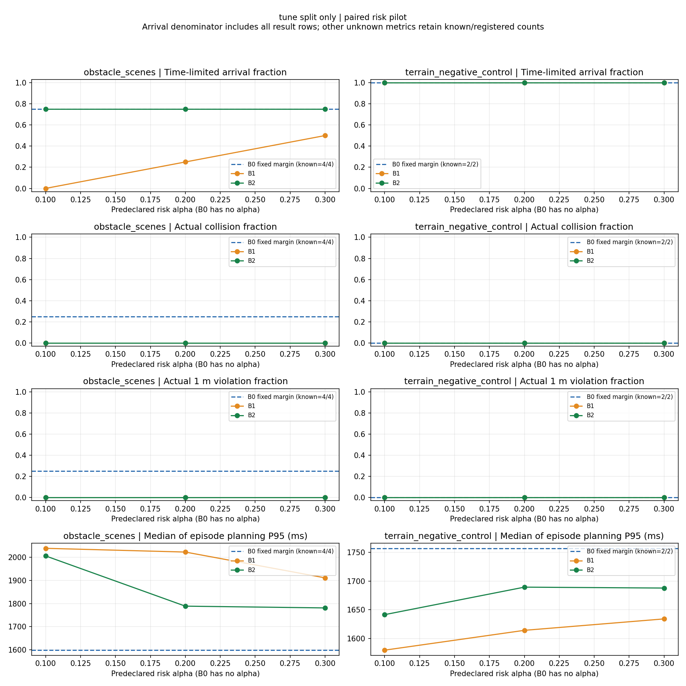

# 阶段4：CA风险处理最小可行性实验结果

本轮已实现B0原工程包络、B1独立校准误差球、B2候选相关冻结ECP，并保留共同原REMUS六自由度闭环。独立测试显示B2缓解了本轮B1全时域球的停滞，但还没有建立优于B0的可靠安全—到达优势。没有将ECP已有原理称作原创，没有增加网络或根据测试结果调整风险阈值。

## 实验单位与共同条件

48个唯一注册场景：6 train、6 tune、24 calibration、12 test，合计36开发场景。正式执行108次：48次B0、36次B1/B2调参、24次B1/B2独立测试。三方法闭环配对比较只覆盖6个调参场景和12个测试场景，不能称为48个三方法独立测试。

共同条件为CA、原45参考网格、diverse短名单及9个完整六自由度验证候选、24秒预测、2秒规划、0.02秒物理积分、200秒任务上限、原4秒硬过期感知、原RPM0滑行和普通已知海床3D A*。原水动力、控制器、执行器、碰撞几何、1米安全裕量及5米到达标准没有改变。风险方法只在同一候选物理前向验证之后改变风险净间隙、可行性及同一代价公式中的间隙项。

α=0.1/0.2/0.3的完整曲线仅用tune角色，独立test在运行前固定α=0.1。B0没有校准α，不因多条曲线重复计作多个样本。原始失败全部保留。

## 独立测试：实际闭环与预测验收分开

| 范围 | 方法 | 限时到达 | 实际碰撞 | 实际1米违规 | 超时 | 原有限时域验收 |
|---|---|---:|---:|---:|---:|---:|
| 8个障碍场景 | B0 | 7/8 | 1/8 | 2/8 | 0/8 | 4/8 |
| 8个障碍场景 | B1 | 1/8 | 0/8 | 0/8 | 7/8 | 0/8 |
| 8个障碍场景 | B2 | 5/8 | 0/8 | 0/8 | 3/8 | 1/8 |
| 4个海床负对照 | B0 | 4/4 | 0/4 | 0/4 | 0/4 | 4/4 |
| 4个海床负对照 | B1 | 4/4 | 0/4 | 0/4 | 0/4 | 4/4 |
| 4个海床负对照 | B2 | 4/4 | 0/4 | 0/4 | 0/4 | 4/4 |

合计12个test的到达数B0/B1/B2为11/5/9。地形没有障碍，不能用四次共同成功夸大ECP的动态避障收益。

`unsafe_emergency_forecast`与原有限时域验收使用**各方法自己的预测包络**。较大q本身更容易把滑行标为危险，因此不能仅凭有限验收4/8与1/8断言B0真实更安全。实际碰撞、实际1米违规、限时到达和预测不可行分别解释。B1/B2本组没有实际碰撞，也不能证明总体碰撞率为零。

障碍测试应急总次数B0/B1/B2为58/509/339，不安全应急预测为41/435/207。B2减少了相对B1的停滞与应急，但仍有三个超时。`minimum_actual_clearance_m`是障碍、海床及海域约束中的最小实际净间隙，不是仅障碍距离。

## 校准与已确定机制

24个校准场景含16个有障碍与8个明确无障碍场景；72个有效窗口、127个匹配目标窗口不作为127个独立校准场景。校准角色中的19到达、2碰撞、3超时全部使用并保留。1498个障碍快照按原物理时钟回放，最大位置差0米。

B1在α=0.1/0.2/0.3的额外半径约63.041/46.435/45.100米，未截断。它是全场景、全24秒统一球，未复现原P25逐预测步及速度分箱，因此只能比较本轮球适配，不能宣称优于完整P25。B2是每候选全时域scene-max校准，不是CDC作者完整在线ACP。

实际静态校准历史显示，0.02米测量噪声经CA差分加速度和24秒外推后可产生约29–33米误差。全时域最大值进一步使统一球保守。两个指定B0 t=40秒状态的全45参考检查中，B1/B2都拒绝全部参考，而事后保持参考真值分别有5/45和45/45安全。原9短名单在静态状态已含一条真值安全参考，所以该两状态不是单纯增加候选预算即可解决。它们不是总体误判率，也不等于实际闭环未来24秒继续保持该动作。

B1/B2分别有5/6个障碍test出现正q归零，均对应曾见目标后追踪集合变空。原4秒删除规则共同保留；q=0不表示真实目标消失或零风险。轨迹影响FOV和后续交付，故任务差异含风险—运动—感知反馈，不能全部归于直接校准精度。

## 独立调参安全—效率曲线

以下仅4个有障碍tune场景，另2个地形负对照均到达且没有风险项作用。全部预登记α都报告，没有以test结果选择一个有利阈值。

| 方法 | α | 到达/4 | 碰撞/4 | 实际1米违规/4 | 应急次数 | 不安全应急预测次数 | 已观测锚点额外项覆盖 |
|---|---:|---:|---:|---:|---:|---:|---:|
| B0 | 无 | 3 | 1 | 1 | 8 | 4 | 未定义 |
| B1 | 0.1 | 0 | 0 | 0 | 257 | 232 | 11/12 |
| B1 | 0.2 | 1 | 0 | 0 | 216 | 110 | 8/12 |
| B1 | 0.3 | 2 | 0 | 0 | 212 | 62 | 8/12 |
| B2 | 0.1 | 3 | 0 | 0 | 169 | 80 | 11/12 |
| B2 | 0.2 | 3 | 0 | 0 | 161 | 37 | 11/12 |
| B2 | 0.3 | 3 | 0 | 0 | 154 | 21 | 11/12 |

曲线支持本轮B2较统一球更少停滞，但只有每障碍族一个tune场景，不能据此推断总体优势。覆盖分母为相关规划锚点，不是独立场景数。

## 同状态选择、误判和覆盖

正式三批结束后，单进程离线分析全部108次运行，完成209个固定20/40/60秒的有效选中参考锚点。原B0的完整控制器、执行器和参考状态先按原控制历史恢复；重算B0动作、可行性和净间隙均与归档匹配，候选评估没有修改恢复状态。

独立test的22个B0实际状态各评估三方法，合计66个决定。B1与B2各19/22次改变B0动作，但**B1与B2仅1/22次即时动作不同**，不能声称ECP普遍改变选择。唯一差异是`static3d_v01_s410001`的20秒：B1无可行候选并滑行，B2有8个预测可行候选，选800RPM、目标航向0.974633弧度。两固定t40全45检查则都选择滑行。B0状态上的局部影子对照不能代表B2自身闭环访问的全部状态。

| 独立障碍test | 选中参考有效锚点 | 预测可行却24秒保持参考不满足实际裕量 | 额外校准项覆盖 |
|---|---:|---:|---:|
| B0 | 22 | 3 | 无校准项，未定义 |
| B1 | 24 | 0 | 24/24 |
| B2 | 23 | 0 | 22/23 |

误判列只评价选中参考**继续保持24秒**的反事实路径，包含未来真实未观测障碍；不是实际闭环碰撞数，也不是全部45候选误判率。覆盖只评价有已交付目标时选中参考的额外项分数，忽略共同工程包络，不是整个包络的覆盖率。海床负对照没有目标，锚点标签数0、覆盖未定义。不同闭环失联时间不同，分母因此不同；不能将相关锚点的22/23解释为独立场景的概率安全认证。

## 计算、感知与预测误差

下表为批次结束后、同一22状态、单进程顺序运行的影子规划墙钟时间。每锚点顺序固定B0/B1/B2，样本少、操作系统负载未完全控制；它比多批并发结果更可比，但不是严格实时认证。额外重放/真值评价时间不计入规划耗时。

| 方法 | 同状态规划P95/ms | 超2秒次数/22 | 预测可行决定/22 |
|---|---:|---:|---:|
| B0 | 1705.97 | 0 | 19 |
| B1 | 1870.95 | 1 | 0 |
| B2 | 2184.04 | 2 | 1 |

B2本轮没有显示计算优势，且P95超过2秒。原正式障碍test中，各episode P95的中位数B0/B1/B2约2028.57/2145.16/2200.05ms，超周期60/535、205/790、243/725；这些含不同并发负载，不能当作纯方法耗时对比。同步规划暂停物理时钟，没有把这些超周期实际延迟注入执行。

障碍test中30米净间隙以内的“case×对象”近距离交互计数B0/B1/B2为15/0/3，失联对象计数15/13/14，单次最多观测/跟踪均为3。B1的零交互伴随7次超时，不能称为更高效避障。原固定4秒删除次数和正q归零反馈另见[观测耦合记录](experiments/OBSERVATION_RISK_COUPLING_20261012.md)。

| CA预测时域/s | B0 RMSE/m，43目标标签 | B1 RMSE/m，48目标标签 | B2 RMSE/m，47目标标签 |
|---|---:|---:|---:|
| 3 | 0.514 | 0.497 | 0.502 |
| 6 | 1.723 | 1.670 | 1.687 |
| 9 | 3.697 | 3.579 | 3.616 |
| 12 | 6.478 | 6.260 | 6.326 |
| 18 | 14.636 | 14.098 | 14.247 |
| 24 | 26.486 | 25.448 | 25.717 |

所有方法是同一CA；上表按各自闭环实际交付历史在固定锚点匹配真值，目标总体和分母不同，不能把小差异当作预测器改进。同状态对照共享完全相同的CA预测。短时所选REMUS预测与实际执行误差接近零源于共同确定性模型，不代表实艇没有执行误差。

20组海床负对照已逐值核对：12 tune方法/α配对与8 test配对，6个唯一海床case，实际状态、控制、所有选中预测、动作/决策及结局最大绝对差均0。它们验证共同底座一致性，不属于ECP收益。

## 结果文件和图像

- [108行统一指标CSV](experiments/EXPERIMENT_SUMMARY.csv)、[全部共同参数/角色/种子](experiments/EXPERIMENT_CONFIG.json)、[分组数值与时延](experiments/FINAL_REVIEW_METRICS_20261012.json)。
- [同状态动作CSV](experiments/SAME_STATE_SHADOW_DECISIONS.csv)、[全45离线诊断](experiments/FULL45_INTERPRETATION.md)、[20组负对照](experiments/negative_control_review_20261012.json)。
- [真实静态失败三维图](figures/static_actual_3d.png)、[动态交叉三维图](figures/crossing_actual_3d.png)、[交叉控制与执行误差图](figures/crossing_risk_controls_error.png)。
- [山脊航迹](figures/terrain_actual_3d.png)、[Perlin航迹](figures/perlin_actual_3d.png)、[独立test结果图](figures/risk_curves_test.png)。

全108次原始轨迹、所有失败、校准来源、完整离线标签、代表性GIF/HTML和实际JUnit另存本地审查ZIP，不上传成批运行产物。没有任何额外文件摘要校验。

## 可复现资料与方法边界

- [逐场景失败分析](FAILURE_ANALYSIS.md)、[实际测试与命令](TEST_REPORT.md)、[方法定义与作者来源](RISK_METHODS.md)、[后续最小验证](NEXT_STEPS.md)。
- 统一指标CSV、调参安全—效率曲线、固定锚点覆盖和同状态动作对照随本轮结果保存，不能混合split、预算或地形负对照计算一个总成功率。
- 三方法都使用CA；没有新增PPLNM对照、在线ACP、Transformer、强化学习或电功率标定。同步规划期间物理时钟暂停，墙钟延迟未自动加入实际执行。
- 本轮测试已用于评价和失败诊断。下一轮改校准形态、CA或感知后，必须另设新heldout，不得继续称当前12个test为未见测试。
